# SignSetu — Real-time Indian Sign Language to Text & Speech

> *"setu" = bridge.* SignSetu turns Indian Sign Language gestures into on-screen text and spoken words, live from a webcam, with a Hindi caption for every sign.


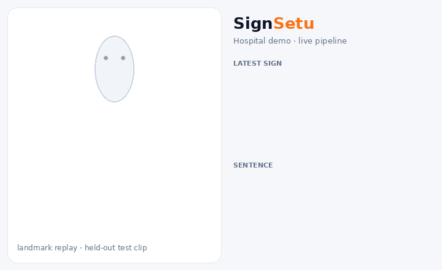

*The GIF is generated by the notebook from real held-out test predictions: four correctly classified clips from four categories, drawn from the stored landmark features (hands positioned relative to the face).*

---

## Table of contents
1. [Problem statement](#1-problem-statement) · 2. [Team](#2-team) · 3. [Problem description & scope](#3-problem-description--scope) · 4. [Our approach](#4-our-approach) · 5. [Dataset](#5-dataset) · 6. [Tech stack](#6-tech-stack) · 7. [Results](#7-results) · 8. [Screenshots](#8-screenshots) · 9. [Setup & installation](#9-setup--installation) · 10. [Running locally](#10-running-locally) · 11. [Using the app](#11-using-the-app) · 12. [Database schema](#12-database-schema) · 13. [Project structure](#13-project-structure) · 14. [Limitations & future work](#14-limitations--future-work) · 15. [Responsible use & privacy](#15-responsible-use--privacy) · 16. [AI tools used](#16-ai-tools-used) · 17. [Acknowledgements](#17-acknowledgements)

---

## 1. Problem statement
**Neural Storm 2026 (JNTUH × Unstop) · Track 01 Future Tech · FT-04 — Sign Language to Text/Speech Translator**

> *"Design a real-time computer vision application that translates Indian Sign Language gestures into text and synthesised speech."*

## 2. Team
**Team AlphaFire**

| # | Member |
|---|---|
| 1 | Kavay Khurana |
| 2 | Gurliv Singh |
| 3 | Harshit Atal |

## 3. Problem description & scope
Millions of deaf and hard-of-hearing people in India use Indian Sign Language (ISL). In clinics, banks, offices and classrooms there is often nobody present who can interpret, and a pen-and-paper exchange is slow and excludes people who are not fluent in written language. A tool that watches a signer and produces text and speech can lower that barrier.

**What we built:** a complete, local, real-time pipeline for **isolated ISL signs** — 300 signs covering words, the letters A–Z and the digits 0–9 — plus a **"Not a sign"** class so the system can say nothing when the person is idle, mid-transition, or signing something it does not know.

**What we deliberately did not attempt:** continuous sentence-level recognition, fingerspelling of arbitrary words, or ISL grammar. Those are listed under [future work](#14-limitations--future-work).

## 4. Our approach

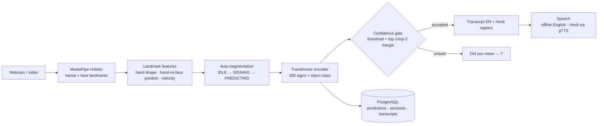

* **Landmarks, not pixels.** The model never sees the image. MediaPipe Holistic reduces each frame to hand and face landmarks, which makes the classifier independent of background, clothing and lighting, and fast enough for CPU real-time use. Frames are processed locally and never stored.
* **Features (506 per frame × 20 frames).** For each hand: wrist-centred, scale-normalised hand shape; the same hand expressed relative to the face (nose tip, scaled by the distance between the outer eye corners); frame-to-frame velocity; and two presence flags.
* **Auto-segmentation.** A small state machine watches for hands becoming active (with a 5-frame pre-roll), ends the sign after a configurable number of idle frames, and classifies the segment. A push-to-sign mode (countdown + fixed capture) is also available.
* **Models.** A 2-layer BiGRU baseline and the main model, a 4-layer pre-norm Transformer encoder with a CLS token. Both are trained with identical data, GPU augmentation (mirror flip, in-plane rotation, temporal crop and speed change, noise, hand blanking, frame hold, and scale/offset jitter on the face-relative block), AdamW with warm-up + cosine decay, label smoothing, AMP and early stopping.
* **Confidence gating.** A word is added only if top-1 probability ≥ threshold **and** the top-1/top-2 margin is large enough; otherwise the app asks "did you mean …?" with the top three. Corrections are logged.
* **Test-time augmentation (TTA)** (average with the mirrored sequence) is evaluated on the validation set and only enabled in the app if it helps there.
* **ONNX path.** The Transformer (input normalisation included) is exported to ONNX and verified against PyTorch, so it can run with ONNX Runtime on CPU.

## 5. Dataset
**Vāksetu ISL Feature Dataset (v1.0)** — *300-Class Indian Sign Language Sequences with Adapter and Phase-2 Refinement Splits*, Zenodo record **[23004815](https://zenodo.org/records/23004815)**. It contains pre-computed MediaPipe-derived **features only — no videos or images**. Each sample is 20 frames × 506 values. Consult the Zenodo record for its licence and terms. The data is **not redistributed** in this repository.

Part of it (the `MVI` domain) was extracted from videos of the **INCLUDE** dataset: Sridhar, Ganesan, Kumar, Khapra — *"INCLUDE: A Large Scale Dataset for Indian Sign Language Recognition"*, ACM Multimedia 2020, [doi:10.1145/3394171.3413528](https://doi.org/10.1145/3394171.3413528) (CC BY 4.0).

### What the notebook does with it

| Step | Decision | Why |
|---|---|---|
| Integrity | SHA-256 of the HDF5 file is verified against the published checksum | detect a corrupt download |
| Features | Read the 252 base values per frame; **recompute velocity** as the frame difference | verified identical to the stored velocity on the webcam domain (max abs diff 0.0000) |
| Dropped column | The 253rd "hand-to-face proximity" column is **excluded** | its definition cannot be recovered from the data, so the live pipeline could not reproduce it faithfully |
| De-duplication | 42,503 exact duplicate arrays removed (first kept); 1,084 arrays that appear under conflicting labels removed | the dataset itself reports heavy duplication; duplicates would leak across splits |
| Reject class | `negative` + `refining_negative` clips (idle, transitions, tracking failures, non-signing movement, …) become a 301st class, **Not a sign** | lets the app abstain |
| Cross-domain hold-out | The whole `MVI` domain (920 clips, **10 sign classes**) is held out and never trained on | the only test with a different data source |
| In-domain split | Real webcam/unknown clips split per class 80/10/10 (seed 42); synthetic `cvae` clips and augmented variants are train-only | no official split exists |
| Leakage guard | The notebook asserts no array hash is shared between train / val / test / cross-domain | fails the run if violated |

> The dataset has **no signer IDs**, so the in-domain test split may share signers (and near-identical recordings) with training. Read the in-domain numbers as an upper bound and the cross-domain number as the more honest — but narrow (10 classes) — generalisation check.

## 6. Tech stack

| Layer | Technology | Purpose |
|---|---|---|
| Landmarks | MediaPipe Holistic 0.10.21 | hand + face landmarks from webcam / video |
| Deep learning | PyTorch 2.8 (CUDA 12.8), AMP | BiGRU baseline, Transformer encoder, GPU augmentation |
| Inference | PyTorch CUDA/CPU, ONNX Runtime 1.20 | switchable engines in the app |
| Data | h5py, NumPy 1.26, pandas, scikit-learn | HDF5 features, splits, metrics |
| Database | PostgreSQL + psycopg 3 (+ pool) | vocabulary, samples, training runs, predictions, transcripts |
| UI | Streamlit 1.40, Plotly | six-page web app |
| Speech | pyttsx3 (offline, espeak), gTTS (Hindi, online) | text-to-speech |
| Vision I/O | OpenCV (via MediaPipe), Pillow, imageio | camera/video decoding, GIF rendering |

All libraries are open source.

## 7. Results

<!-- METRICS:START -->
_Auto-generated by `SignSetu.ipynb` from `reports/metrics.json` (2026-11-02 16:32:23). Hardware: NVIDIA GeForce RTX 5050 Laptop GPU (8 GB, driver 615.78.08), AMD Ryzen 7 250 w/ Radeon 780M Graphics._

**Data used:** 300 sign classes + 1 reject class · train 41,319 · val 4,732 · in-domain test 4,732 · cross-domain test (MVI) 920

| Model | Params | Test top-1 | Test top-5 | Macro-F1 | Balanced acc. | Top-1 + TTA | Cross-domain top-1 (MVI) |
|---|---:|---:|---:|---:|---:|---:|---:|
| BiGRU baseline | 1.55 M | 98.59% | 99.78% | 98.73% | 98.66% | 98.57% | 81.63% |
| **Transformer (SignSetu)** | 2.32 M | **98.79%** | **99.78%** | **98.84%** | **98.83%** | 98.72% | **85.54%** |

Transformer reject-class recall: 94.21% · false-reject rate on sign clips: 0.17% · TTA enabled in app: no · trained 15.5 min (best epoch 171).

**Per-category test top-1 (Transformer):**

| Category | Top-1 |
|---|---:|
| Alphabet | 100.0% |
| Time & Frequency | 100.0% |
| Greetings & Phrases | 100.0% |
| Objects | 100.0% |
| Days | 100.0% |
| Question Words | 100.0% |
| Actions | 99.6% |
| Position & Direction | 99.5% |
| Numbers | 99.5% |
| Colors | 99.4% |
| Emergency & Health | 99.3% |
| Descriptions & Other | 98.0% |
| Pronouns | 96.0% |

**Latency** (single sample, AMD Ryzen 7 250 w/ Radeon 780M Graphics; GPU NVIDIA GeForce RTX 5050 Laptop GPU (8 GB, driver 615.78.08)):

| Stage | Mean | p95 |
|---|---:|---:|
| Transformer · PyTorch CUDA | 0.64 ms | 0.73 ms |
| Transformer · PyTorch CPU | 0.95 ms | 1.28 ms |
| Transformer · ONNX Runtime CPU | 0.63 ms | 0.88 ms |
| MediaPipe Holistic · CPU, 640 px | 10.5 ms / frame | — |

Estimated end-to-end real-time rate ≈ **90 FPS** (Holistic + best model path). Holistic benchmark input: CC BY-SA 4.0 sign-language clip (Wikimedia Commons), 1080p resized to 640 px.
<!-- METRICS:END -->

### How to read these numbers
* **Test (in-domain)** is a held-out split of the same recordings the model trained on; the dataset has no signer IDs, so it likely overstates performance on a new signer. Treat it as an upper bound.
* **Cross-domain (MVI)** is data from a different source that was never trained on — a stricter test, but it covers only **10 of the 300 signs**.
* **Reject-class recall / false-reject rate** show how reliably the model abstains on non-signing clips versus wrongly abstaining on real signs.
* The most frequent errors are semantically close pairs (see the confused-pairs chart), e.g. *Good ↔ Nice* and *His ↔ Him*.
* Latency numbers are single-sample on the hardware listed in the block; Holistic was benchmarked on a 1080p clip downscaled to 640 px (see [acknowledgements](#17-acknowledgements)).
* No published INCLUDE baseline is quoted: our dataset, splits and class set differ from the paper's, so a comparison would not be like-for-like.

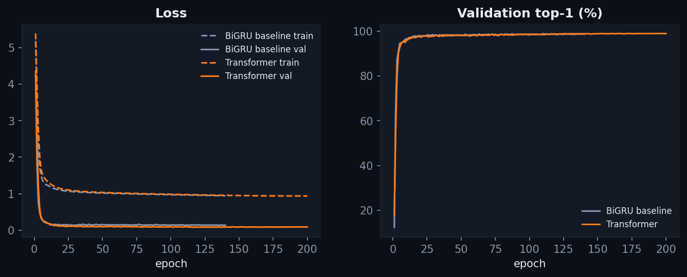
*Training curves. Training loss sits above validation loss because it is measured under augmentation and label smoothing.*

| | |
|---|---|
| 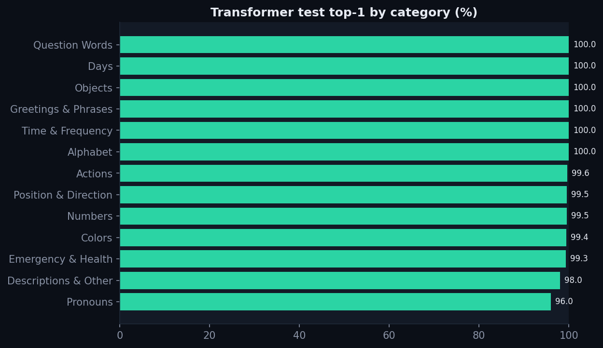 | 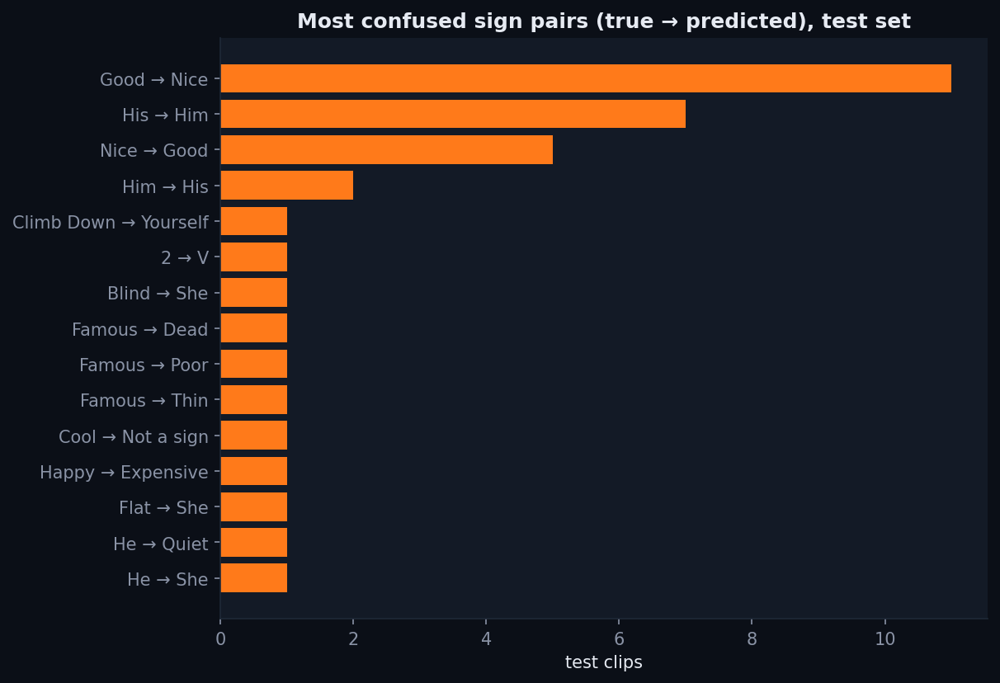 |
| 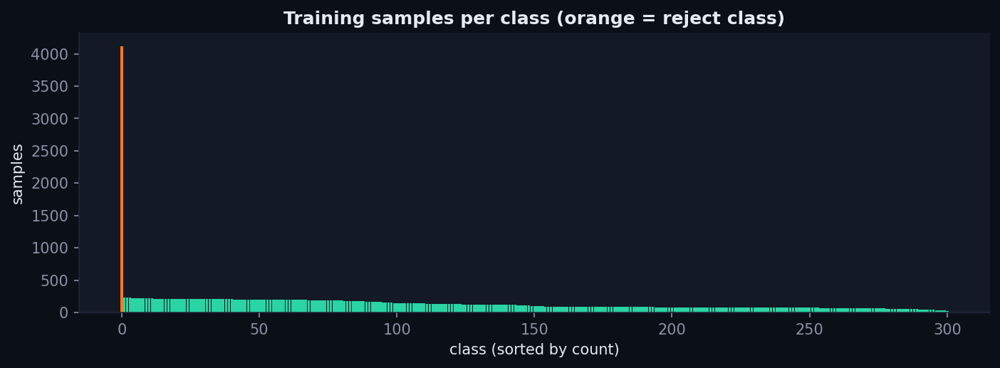 | 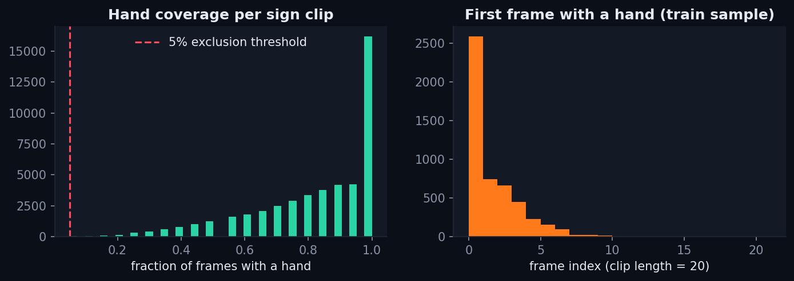 |

## 8. Screenshots

**Live Translate** — the simulate mode replays held-out test clips through the exact live pipeline (segmentation → classification → confidence gate → transcript). With a real camera the same page shows the landmark-annotated webcam feed.
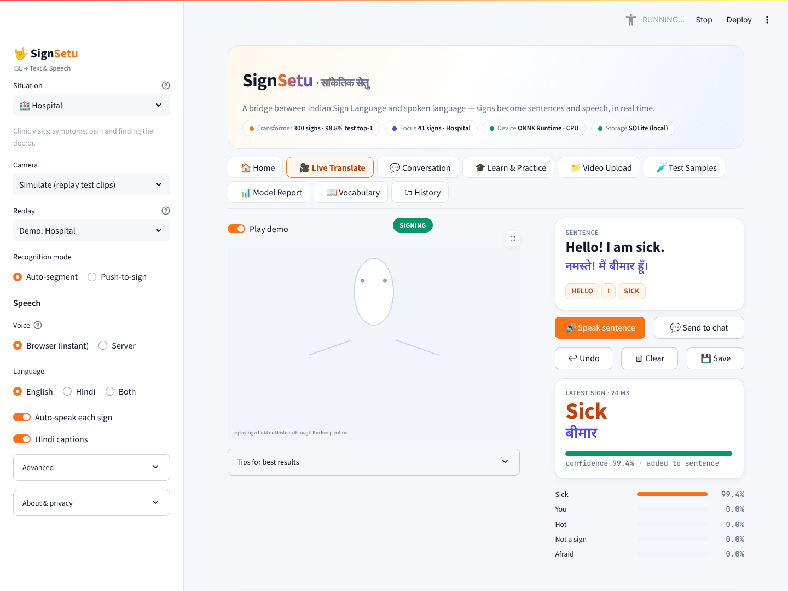

**Video Upload** — landmarks are extracted from an uploaded clip and classified; timing and hand coverage are reported. *The screenshot uses a non-ISL (Armenian Sign Language) test clip with the video preview hidden, so the correct outcome is "No sign detected" (the model's "Not a sign" class). It only demonstrates the pipeline and readouts.*
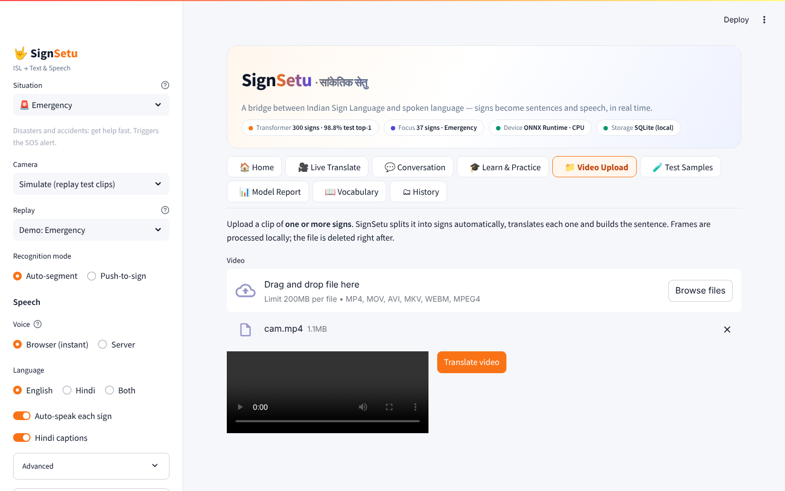

**Test Samples** — held-out clips with the prediction, the ground truth and a ✓/✗ badge; every pick is logged with its ground truth.
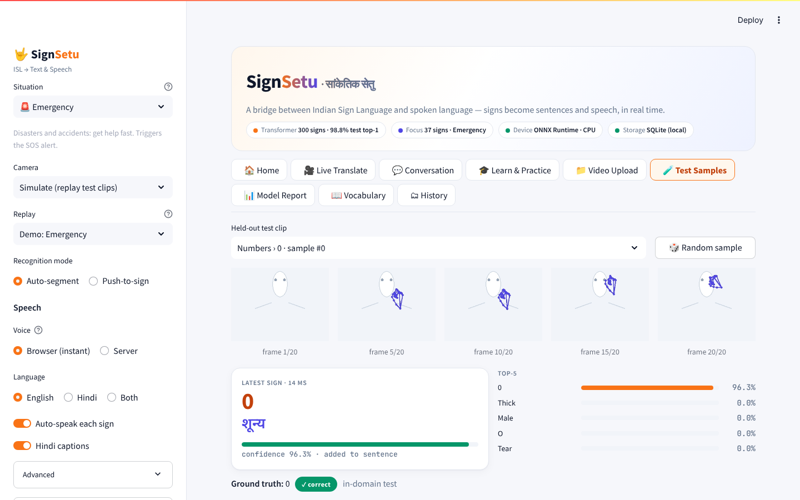

**Model Report** — metrics, baseline comparison and training curves (from the database).
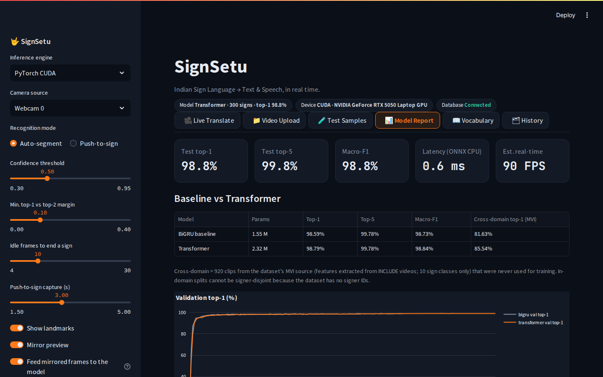

**Vocabulary** — searchable list of all signs with Hindi caption, training samples and test F1.
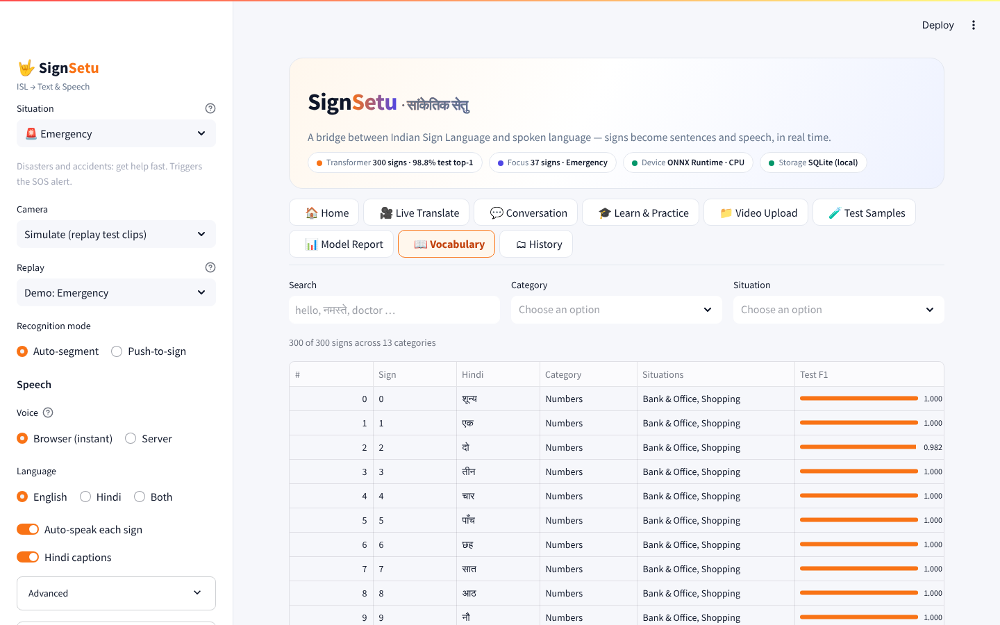

**History & analytics** — everything the app has recognised, from PostgreSQL.
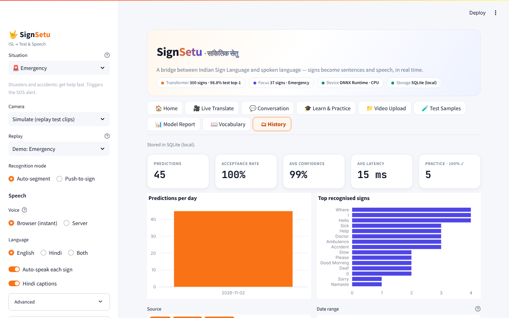

## 9. Setup & installation
Developed and tested on **Fedora Linux 44** (AMD Ryzen 7, 14 GB RAM, NVIDIA RTX 5050 Laptop GPU, driver CUDA 13.4, PostgreSQL 18.6). Windows 11 should work (the code selects the DirectShow camera backend there) but has **not been tested**.

**Prerequisites**
* Python **3.11** · PostgreSQL **16 or newer** · Git
* An NVIDIA GPU is recommended for training (≈25 min here); inference runs comfortably on CPU
* About 3 GB of disk for the dataset (2.2 GB) and caches, plus the Python environment (~8 GB with CUDA wheels)
* Linux: `espeak-ng` for offline English speech (`sudo dnf install espeak-ng` / `sudo apt install espeak-ng`)

**1. Clone**
```bash
git clone https://github.com/harshit174/SignSetu.git
cd SignSetu
```

**2. Python environment**
```bash
python3.11 -m venv .venv
source .venv/bin/activate            # Windows: .venv\Scripts\activate
pip install -r requirements.txt
python -m ipykernel install --user --name signsetu --display-name "Python 3.11 (SignSetu)"
```
`requirements.txt` pulls PyTorch from the CUDA 12.8 index (needed for RTX 50-series GPUs; older GPUs can use any CUDA build). Some pins are deliberate and commented in the file (e.g. `numpy 1.26` and `pyarrow 17` because MediaPipe 0.10.21 needs NumPy < 2).

**3. PostgreSQL** — install the server, start it, and create a role that can log in over TCP with a password. Fedora example:
```bash
sudo dnf install postgresql-server postgresql
sudo postgresql-setup --initdb
sudo systemctl enable --now postgresql
sudo -u postgres psql -c "CREATE ROLE signsetu LOGIN CREATEDB PASSWORD 'choose-a-password';"
```
Make sure `pg_hba.conf` accepts password (`scram-sha-256`) logins for `127.0.0.1` and `::1` (Fedora's default is `ident`; Debian/Ubuntu and the Windows installer already use passwords). The notebook creates the database and all tables itself.

**4. Configuration**
```bash
cp .env.example .env      # then edit PGPASSWORD and DATASET_ROOT
```

**5. Dataset** — download the files of Zenodo record [23004815](https://zenodo.org/records/23004815) (`dataset_consolidated.h5`, `dataset_consolidated.h5.sha256`, `manifest_consolidated.csv`, `quality_flags.csv`) into one folder and point `DATASET_ROOT` at it.

## 10. Running locally
Open **`SignSetu.ipynb`**, choose the kernel **Python 3.11 (SignSetu)** and **Run All**. With zero manual edits it will: check the environment → bootstrap PostgreSQL → verify and load the dataset → split → train the baseline and the Transformer → evaluate → export ONNX → draw figures and the demo GIF → update the metrics block above → write the Streamlit app → start it as a detached background process and open it at **http://localhost:8501**.

Run All never blocks on the app, and re-running it skips finished work (feature cache, config-hash-matched checkpoints).

| Flag (config cell) | Default | Effect |
|---|---|---|
| `SMOKE_TEST` (env `SIGNSETU_SMOKE=1`) | off | 10 classes, 3 epochs; outputs go to `models/smoke/`, `reports/smoke/`, `assets/figures_smoke/` |
| `FORCE_RELOAD` | `False` | re-read the HDF5 file instead of using `data/base_f16.npy` |
| `FORCE_RETRAIN` | `False` | retrain even if a matching checkpoint exists |
| `SEED` | `42` | seeds Python, NumPy and PyTorch |
| `LAUNCH_APP` (env `SIGNSETU_NO_LAUNCH=1` turns it off) | on | start Streamlit at the end |
| `APP_PORT` | `8501` | first port tried (falls back to 8502–8510) |
| `STOP_APP` | `False` | set `True` and run only the last cell to stop the app |

**Expected runtimes (this machine):** first full run ≈ 24 minutes (BiGRU ≈ 8 min, Transformer ≈ 16 min on the GPU, the rest under a minute); a cached re-run ≈ 30 seconds including app start.

**Run only the app** (after the notebook has produced `models/`):
```bash
source .venv/bin/activate
streamlit run app.py
```
`isl_core.py`, `app.py` and `.streamlit/config.toml` are **generated by the notebook** — edit the notebook cells, not these files.

## 11. Using the app

| Page | What it does |
|---|---|
| 🎥 **Live Translate** | Webcam (or "Simulate with test sample") → landmarks → auto-segmentation or push-to-sign → word, Hindi caption, top-5, transcript, speak / undo / clear / save |
| 📁 **Video Upload** | Classify a short clip of one sign (mp4, mov, avi, mkv, webm up to 200 MB) |
| 🧪 **Test Samples** | Held-out clips with prediction vs ground truth |
| 📊 **Model Report** | Metrics, baseline vs Transformer, curves, confused pairs |
| 📖 **Vocabulary** | Search all signs, categories, Hindi, F1 |
| 🗂 **History** | Prediction analytics, recent predictions, saved transcripts, CSV export |

Sidebar controls: inference engine (PyTorch CUDA / CPU / ONNX Runtime), camera source, recognition mode, confidence threshold, top-1/top-2 margin, idle frames to end a sign, push-to-sign capture length, landmark/mirror/Hindi toggles, auto-speak, and speech language.

**Tips for best results:** sit 1–1.5 m from the camera with head-to-waist in frame · even front lighting, plain background · start and end every sign with both hands resting below your chest · one sign at a time. Keep **"Feed mirrored frames to the model"** on: the training data was recorded on a mirrored webcam feed.

## 12. Database schema
PostgreSQL, created idempotently by the notebook (`schema_version` 1).

| Table | Purpose |
|---|---|
| `schema_meta` | schema version |
| `vocabulary` | the 300 signs + reject class: gloss, category, Hindi caption |
| `samples` | every dataset clip: source group, HDF5 index, domain, split, hash, hand coverage, exclusion flag |
| `training_runs` | one row per model run: config, device, params, best epoch, test metrics, checkpoint path |
| `epoch_metrics` | per-epoch loss / accuracy / learning rate for every run |
| `class_metrics` | per-class precision / recall / F1 / support for every run |
| `app_sessions` | one row per app session and mode (live / upload / sample) |
| `predictions` | every prediction: top-1, confidence, top-5, accepted?, user-corrected?, ground truth, timings |
| `transcripts` | saved transcripts with language |

No video frames or images are ever stored. If the database goes down the app keeps translating and shows a notice.

## 13. Project structure
```
SignSetu/
├── SignSetu.ipynb              the only hand-authored source — Run All builds and launches everything
├── isl_core.py                 generated: features, augmentation, models, live extraction, segmentation, inference, DB, speech
├── app.py                      generated: Streamlit UI
├── .streamlit/config.toml      generated: theme and server settings
├── requirements.txt            pinned dependencies
├── .env.example                documented configuration keys (no secrets)
├── models/
│   ├── signsetu_transformer.pt   best Transformer checkpoint (weights + config + labels + feature version)
│   ├── signsetu_transformer.onnx ONNX export
│   ├── baseline_bigru.pt         baseline checkpoint
│   ├── label_map.json            class index → gloss, category, Hindi
│   └── demo_samples.npz          small set of held-out clips for the "Test Samples" page and simulate mode
├── reports/
│   ├── metrics.json              every evaluation number in this README
│   └── classification_report.csv per-class precision / recall / F1 / support
└── assets/
    ├── demo.gif                  generated from real test predictions
    ├── figures/                  training curves, per-category accuracy, confused pairs, class distribution, hand coverage
    └── screenshots/              the six screenshots above
```
(`data/` and `logs/` are created locally and git-ignored.)

## 14. Limitations & future work
* **Isolated signs only** — no continuous signing, no fingerspelling of arbitrary words, no ISL grammar.
* **Feature fidelity** — the dataset documents its features in prose but does not ship the extraction code. We inferred the exact definition (hand normalisation, nose-tip reference, eye-corner scale) from the data and checked it on real video, and we train with scale/offset jitter to tolerate residual mismatch — but **live accuracy on a new signer and camera has not been measured systematically**.
* **Signer generalisation** — no signer IDs exist, so in-domain scores are optimistic; the cross-domain check covers only 10 classes.
* **Hindi captions are word-level translations**, not ISL grammar; Hindi *speech* needs internet (gTTS) and falls back to English offline.
* **Reject class** is trained on the dataset's own non-sign categories; unusual backgrounds or signs from other sign languages may still be mis-accepted (the confidence gate mitigates this).
* **Windows** has not been tested.
* **Next steps:** continuous SLR with CTC, a signer-disjoint evaluation set, fingerspelling, on-device mobile inference through the ONNX model, and a user study with ISL users.

## 15. Responsible use & privacy
SignSetu recognises 300 isolated Indian Sign Language signs (words, letters and digits) from the Vāksetu ISL Feature Dataset. It is an assistive prototype, not a certified interpreter. Video frames are processed locally on this device and never stored; only predicted words, confidence scores and saved transcripts are logged to the local PostgreSQL database.

## 16. AI tools used
* **Claude** (Anthropic) — used to design the project brief, architecture and evaluation plan.
* **Claude Code** (Anthropic) — used for implementation, debugging and testing in this repository.

How the output was checked: the whole notebook was executed end to end on a fresh kernel and re-executed from cache; it asserts leakage-freedom, feature determinism, finite values and ONNX/PyTorch parity (printing `PASS`); and the app was driven through a real browser (all pages, simulate mode, video upload, webcam start/stop and device release, speech) while reading its logs and database.

## 17. Acknowledgements
* The authors of the **Vāksetu ISL Feature Dataset** (Zenodo record 23004815).
* The authors of **INCLUDE** — Sridhar, Ganesan, Kumar, Khapra — and **AI4Bharat**.
* **Google MediaPipe**, **PyTorch**, **Streamlit**, **PostgreSQL**, **ONNX Runtime** and the wider open-source community.
* **Neural Storm 2026** and the **JNTUH** organisers.
* Latency benchmarking and pipeline testing used a short clip from Wikimedia Commons — *[Armenian Sign Language (ArSL) – new](https://commons.wikimedia.org/wiki/File:Armenian_Sign_Language_(ArSL)_-_%D5%B6%D5%B8%D6%80_-_new.webm)* (operator Lusine Bekaryan, video editor Armine Bekaryan, interpreter Gohar Melikyan, for Wikimedia Armenia), licensed **CC BY-SA 4.0**. It is downloaded on demand into the git-ignored `data/` folder, is not part of this repository, and is not ISL.
