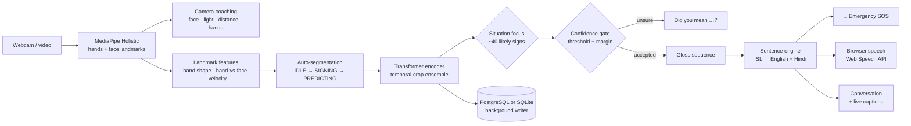

<div align="center">

# 🤟 SignSetu · सांकेतिक सेतु

**A real-time bridge between Indian Sign Language and spoken language.**
Signs become natural English & Hindi sentences — spoken aloud instantly — and the hearing person's reply comes back as large live captions.


**300 ISL signs · 98.8% test top-1 · ~1 ms inference on CPU · fully offline core**


<sub>The Hospital demo: real held-out test clips replayed through the live pipeline (segmentation → Transformer → confidence gate). Glosses line up and the sentence engine turns <code>HELLO I SICK DOCTOR WHERE</code> into “Hello! I am sick. Where is the doctor?”</sub>

</div>

---

## Contents
[Why it matters](#why-it-matters) · [Highlights](#highlights) · [Demo script for judges](#demo-script-for-judges-2-minutes) · [From signs to sentences](#from-signs-to-sentences) · [Problem statement](#1-problem-statement) · [Team](#2-team) · [Scope](#3-problem-description--scope) · [Approach](#4-our-approach) · [What changed vs. v1](#5-what-changed-vs-v1) · [Dataset](#6-dataset) · [Tech stack](#7-tech-stack) · [Results](#8-results) · [Screenshots](#9-screenshots) · [Quick start](#10-quick-start) · [Full setup](#11-full-setup-training-from-scratch) · [Using the app](#12-using-the-app) · [Storage](#13-storage--database-schema) · [Project structure](#14-project-structure) · [Limitations](#15-limitations--future-work) · [Responsible use](#16-responsible-use--privacy) · [AI tools](#17-ai-tools-used) · [Acknowledgements](#18-acknowledgements)

---

## Why it matters
By widely cited estimates, **around 63 million people in India live with significant hearing loss**, while the country has **only a few hundred certified ISL interpreters**. At a clinic counter, a bank, a police station or a classroom there is usually nobody who can interpret — and pen-and-paper is slow, and excludes people who are not fluent in written language.

SignSetu runs on an ordinary laptop webcam, needs no gloves or special hardware, keeps video on the device, and turns ISL into **full sentences and speech** — with an **emergency mode** for the moments where every second counts.

## Highlights

| | Feature | What it does |
|---|---|---|
| 🗣️ | **Signs → sentences, not word lists** | An offline grammar engine (`isl_lang.py`) turns ISL's topic-comment, question-final order into natural **English and Hindi** (with possessive gender agreement in Hindi, e.g. *मेरी किताब*). Optional Claude polish when `ANTHROPIC_API_KEY` is set. |
| 🚨 | **Emergency SOS** | HELP, ACCIDENT, AMBULANCE, FIRE, PAIN … trigger a pulsing full-width alert, speak the request aloud immediately and show India's emergency numbers (**112** · Ambulance **108** · Police **100** · Fire **101**). |
| 🎯 | **Situation focus** | Six presets — Everyday, Hospital, Emergency, Bank & Office, Classroom, Shopping — restrict recognition to ~40 likely signs instead of 300, a large practical accuracy gain for live use. |
| 🔊 | **Instant speech** | Speech runs in the viewer's browser (Web Speech API, `en-IN` / `hi-IN`) with zero start-up delay; server voices (pyttsx3 / gTTS, cached) are a fallback. |
| 💬 | **Two-way conversation** | Quick phrases per situation, **live speech-to-text captions** for the hearing person, typed replies and a downloadable transcript. |
| 🎓 | **Learn & Practice** | Animated reference replay for every sign, a score per attempt, XP, levels, streaks, a daily goal, balloons — and **concrete coaching tips derived from landmarks** ("this sign uses both hands", "raise your hand closer to your face"). |
| 📷 | **Live camera coaching** | Real-time checks for face, light, distance and hands, with a hint for whatever is wrong. |
| 📁 | **Multi-sign video upload** | Auto-segments a clip into signs, translates each one with timestamps and builds the sentence. |
| 🧠 | **Robust inference** | Transformer encoder with temporal-crop ensembling, a "Not a sign" reject class, a confidence + margin gate and "did you mean …?" suggestions. |
| 🗄️ | **Works out of the box** | PostgreSQL when configured, automatic **SQLite fallback** otherwise — every page, including History, works right after `pip install`. |

## Demo script for judges (2 minutes)
No webcam needed — every demo replays **real held-out test clips** through the exact live pipeline.

1. **Run the app** — `streamlit run app.py` and open http://localhost:8501. You land on **🏠 Home**.
2. **Hospital (30 s)** — click **▶ Run the Hospital demo**. Watch the glosses `HELLO I SICK DOCTOR WHERE` line up and become *"Hello! I am sick. Where is the doctor?"* — in English and Hindi — each sign spoken as it is recognised, then the full sentence.
3. **Emergency (20 s)** — back to Home → **▶ Run the Emergency demo**. The SOS banner fires on HELP, and the app speaks each request aloud.
4. **Conversation (30 s)** — open **💬 Conversation**, tap a quick phrase (*"I am deaf. Please help me."*), then type a reply as the hearing person — or press **🎙 Start live captions** in Chrome/Edge and speak.
5. **Learn & Practice (30 s)** — open **🎓 Learn & Practice**, press **🧪 Simulate an attempt** a few times: score, XP, streak and level climb.
6. **Proof (10 s)** — **📊 Model Report** for the metrics, **🗂 History** for everything that was logged.

With a webcam: pick a **Situation** in the sidebar, switch **Camera on** and sign.

## From signs to sentences
ISL is not English word-for-word: it is topic-comment, usually question-final, and drops articles and the verb *to be*. The engine handles these patterns deterministically and offline.

| Signed glosses (ISL order) | English | Hindi |
|---|---|---|
| `HELLO I SICK DOCTOR WHERE` | Hello! I am sick. Where is the doctor? | नमस्ते! मैं बीमार हूँ। डॉक्टर कहाँ है? |
| `HELP ACCIDENT AMBULANCE` | Please help me! There has been an accident! Please call an ambulance! | कृपया मेरी मदद कीजिए! दुर्घटना हुई है! कृपया एम्बुलेंस बुलाइए! |
| `GOOD MORNING I DEAF PLEASE SLOW` | Good morning! I am deaf. Please speak slowly. | सुप्रभात! मैं बधिर हूँ। कृपया धीरे बोलिए। |
| `NAMASTE HOW-ARE-YOU I HAPPY` | Namaste! How are you? I am happy. | नमस्ते! आप कैसे हैं? मैं खुश हूँ। |
| `SORRY MY BOOK WHERE` | I am sorry. Where is my book? | माफ़ कीजिए। मेरी किताब कहाँ है? |
| `YOU SAD WHY` | Why are you sad? | आप उदास क्यों हैं? |

Rules covered: standalone greetings and phrases, wh-questions (wh-final or wh-first), subject + adjective with the right copula (*am / is / are*, *हूँ / है / हैं*), "I need …" for help/doctor/objects, dative states (*मुझे दर्द है*), imperatives with *please*, noun + adjective ("The bag is expensive."), time words, fingerspelled letters and digits, and emergency words.

---

## 1. Problem statement
**Neural Storm 2026 (JNTUH × Unstop) · Track 01 Future Tech · FT-04 — Sign Language to Text/Speech Translator**

> *"Design a real-time computer vision application that translates Indian Sign Language gestures into text and synthesised speech."*

## 2. Team
**Team AlphaFire**

| # | Member |
|---|---|
| 1 | Kavay Khurana |
| 2 | Gurliv Singh |
| 3 | Harshit Atal |

## 3. Problem description & scope
Millions of deaf and hard-of-hearing people in India use Indian Sign Language (ISL). A tool that watches a signer and produces text and speech — and lets the other person answer back — can lower the barrier in everyday places.

**What we built:** a complete, local, real-time pipeline for **isolated ISL signs** — 300 signs covering words, the letters A–Z and the digits 0–9 — plus a **"Not a sign"** class so the system stays quiet when the person is idle, mid-transition or signing something it does not know. On top of the recogniser sit a sentence engine, an emergency mode, a two-way conversation view and a learning mode.

**What we deliberately did not attempt:** continuous sentence-level recognition (signs are segmented one at a time), fingerspelling of arbitrary words beyond letter-by-letter, or full ISL grammar. See [future work](#15-limitations--future-work).

## 4. Our approach



* **Landmarks, not pixels.** The model never sees the image. MediaPipe Holistic reduces each frame to hand and face landmarks, which makes the classifier independent of background, clothing and lighting, and fast enough for CPU real-time use. Frames are processed locally and never stored.
* **Features (506 per frame × 20 frames).** For each hand: wrist-centred, scale-normalised hand shape; the same hand expressed relative to the face (nose tip, scaled by the distance between the outer eye corners); frame-to-frame velocity; and two presence flags.
* **Auto-segmentation.** A state machine watches for hands becoming active (5-frame pre-roll, tolerant of a single dropped detection), ends the sign after a configurable number of idle frames and classifies the segment. A push-to-sign mode (countdown + fixed capture) is also available.
* **Temporal-crop ensemble.** Live segmentation never cuts a sign exactly where the training clips start and end, so each segment is scored as the full hand span plus versions trimmed by 10–20% at either end, in one batch (~2 ms on CPU), and the probabilities are averaged.
* **Situation focus.** Probabilities are restricted to the selected situation's vocabulary (plus the reject class) and renormalised.
* **Models.** A 2-layer BiGRU baseline and the main model, a 4-layer pre-norm Transformer encoder with a CLS token. Both trained with identical data, GPU augmentation (mirror flip, in-plane rotation, temporal crop and speed change, noise, hand blanking, frame hold, scale/offset jitter on the face-relative block), AdamW with warm-up + cosine decay, label smoothing, AMP and early stopping.
* **Confidence gating.** A word is added only if top-1 probability ≥ threshold **and** the top-1/top-2 margin is large enough; otherwise the app offers the top three. A sign split in two by the segmenter is not doubled. Corrections are logged.
* **ONNX path.** The Transformer (input normalisation included) is exported to ONNX and verified against PyTorch; ONNX Runtime CPU is the default engine in the app.

## 5. What changed vs. v1

| Area | v1 | Now |
|---|---|---|
| Output | Space-separated glosses ("slow h things") | Grammatical **English + Hindi sentences** from an ISL-aware engine |
| Live accuracy aids | Single resampled window, all 300 classes | **Situation focus** (~40 signs) + **temporal-crop ensemble** — on held-out clips: in-domain 96.0% → 96.15% clean and 95.4% → 95.8% under simulated live jitter; cross-domain (MVI) subset 83.3% → 85.4% on 48 demo clips |
| Speech latency | New Python process + pyttsx3 start-up for every word; Hindi gTTS fetched synchronously | **Browser Web Speech API — speaks instantly** on the viewer's device; server voices cached as fallback |
| Camera loop | Raw frames pushed to the UI; DB inserts inside the loop (a dead DB froze it for 3 s every 20 s) | Frames sent **inline as compact JPEG** in the websocket message (no per-frame media fetch), status updates only on change, DB writes on a **background thread** |
| Segmentation | Any single dropped hand detection reset the start counter | **Tolerates 1-frame tracking dropouts** |
| Real-world use | Translation only | **Emergency SOS**, **two-way Conversation** with live captions, quick phrases, **camera coaching** |
| Engagement | — | **Learn & Practice** with scores, XP, levels, streaks, daily goal and landmark-based coaching |
| Video upload | One sign per clip | **Multi-sign** clips with auto-segmentation and timestamps |
| Setup | PostgreSQL required for history | **SQLite fallback** — runs after `pip install` |
| Theme | Dark | **Light**, accessible, saffron × indigo |

## 6. Dataset
**Vāksetu ISL Feature Dataset (v1.0)** — *300-Class Indian Sign Language Sequences with Adapter and Phase-2 Refinement Splits*, Zenodo record **[23004815](https://zenodo.org/records/23004815)**. It contains pre-computed MediaPipe-derived **features only — no videos or images**. Each sample is 20 frames × 506 values. Consult the Zenodo record for its licence and terms. The data is **not redistributed** in this repository.

Part of it (the `MVI` domain) was extracted from videos of the **INCLUDE** dataset: Sridhar, Ganesan, Kumar, Khapra — *"INCLUDE: A Large Scale Dataset for Indian Sign Language Recognition"*, ACM Multimedia 2020, [doi:10.1145/3394171.3413528](https://doi.org/10.1145/3394171.3413528) (CC BY 4.0).

### What the notebook does with it

| Step | Decision | Why |
|---|---|---|
| Integrity | SHA-256 of the HDF5 file is verified against the published checksum | detect a corrupt download |
| Features | Read the 252 base values per frame; **recompute velocity** as the frame difference | verified identical to the stored velocity on the webcam domain (max abs diff 0.0000) |
| Dropped column | The 253rd "hand-to-face proximity" column is **excluded** | its definition cannot be recovered from the data, so the live pipeline could not reproduce it faithfully |
| De-duplication | 42,503 exact duplicate arrays removed (first kept); 1,084 arrays that appear under conflicting labels removed | the dataset itself reports heavy duplication; duplicates would leak across splits |
| Reject class | `negative` + `refining_negative` clips (idle, transitions, tracking failures, non-signing movement, …) become a 301st class, **Not a sign** | lets the app abstain |
| Cross-domain hold-out | The whole `MVI` domain (920 clips, **10 sign classes**) is held out and never trained on | the only test with a different data source |
| In-domain split | Real webcam/unknown clips split per class 80/10/10 (seed 42); synthetic `cvae` clips and augmented variants are train-only | no official split exists |
| Leakage guard | The notebook asserts no array hash is shared between train / val / test / cross-domain | fails the run if violated |

> The dataset has **no signer IDs**, so the in-domain test split may share signers (and near-identical recordings) with training. Read the in-domain numbers as an upper bound and the cross-domain number as the more honest — but narrow (10 classes) — generalisation check.

## 7. Tech stack

| Layer | Technology | Purpose |
|---|---|---|
| Landmarks | MediaPipe Holistic 0.10.21 | hand + face landmarks from webcam / video |
| Deep learning | PyTorch 2.8 (CUDA 12.8), AMP | BiGRU baseline, Transformer encoder, GPU augmentation |
| Inference | ONNX Runtime 1.20, PyTorch CUDA/CPU | switchable engines; temporal-crop ensemble |
| Language | `isl_lang.py` (rule-based, offline); optional Anthropic Claude API | ISL gloss → English + Hindi sentences, situations, coaching |
| Speech | Web Speech API (browser); pyttsx3/espeak, gTTS (server fallback) | text-to-speech, live speech-to-text captions |
| Storage | PostgreSQL + psycopg 3 (pool), SQLite fallback | vocabulary, training runs, predictions, transcripts, practice |
| UI | Streamlit 1.40, Plotly | nine-page web app, light theme |
| Data | h5py, NumPy 1.26, pandas, scikit-learn | HDF5 features, splits, metrics |
| Vision I/O | OpenCV, Pillow, imageio | camera/video decoding, reference replays, GIF rendering |

All core libraries are open source; the app's core runs fully offline.

## 8. Results

<!-- METRICS:START -->
_Auto-generated by `SignSetu.ipynb` from `reports/metrics.json` (2026-11-02 16:32:23). Hardware: NVIDIA GeForce RTX 5050 Laptop GPU (8 GB, driver 615.78.08), AMD Ryzen 7 250 w/ Radeon 780M Graphics._

**Data used:** 300 sign classes + 1 reject class · train 41,319 · val 4,732 · in-domain test 4,732 · cross-domain test (MVI) 920

| Model | Params | Test top-1 | Test top-5 | Macro-F1 | Balanced acc. | Top-1 + TTA | Cross-domain top-1 (MVI) |
|---|---:|---:|---:|---:|---:|---:|---:|
| BiGRU baseline | 1.55 M | 98.59% | 99.78% | 98.73% | 98.66% | 98.57% | 81.63% |
| **Transformer (SignSetu)** | 2.32 M | **98.79%** | **99.78%** | **98.84%** | **98.83%** | 98.72% | **85.54%** |

Transformer reject-class recall: 94.21% · false-reject rate on sign clips: 0.17% · TTA enabled in app: no · trained 15.5 min (best epoch 171).

**Per-category test top-1 (Transformer):**

| Category | Top-1 |
|---|---:|
| Alphabet | 100.0% |
| Time & Frequency | 100.0% |
| Greetings & Phrases | 100.0% |
| Objects | 100.0% |
| Days | 100.0% |
| Question Words | 100.0% |
| Actions | 99.6% |
| Position & Direction | 99.5% |
| Numbers | 99.5% |
| Colors | 99.4% |
| Emergency & Health | 99.3% |
| Descriptions & Other | 98.0% |
| Pronouns | 96.0% |

**Latency** (single sample, AMD Ryzen 7 250 w/ Radeon 780M Graphics; GPU NVIDIA GeForce RTX 5050 Laptop GPU (8 GB, driver 615.78.08)):

| Stage | Mean | p95 |
|---|---:|---:|
| Transformer · PyTorch CUDA | 0.64 ms | 0.73 ms |
| Transformer · PyTorch CPU | 0.95 ms | 1.28 ms |
| Transformer · ONNX Runtime CPU | 0.63 ms | 0.88 ms |
| MediaPipe Holistic · CPU, 640 px | 10.5 ms / frame | — |

Estimated end-to-end real-time rate ≈ **90 FPS** (Holistic + best model path). Holistic benchmark input: CC BY-SA 4.0 sign-language clip (Wikimedia Commons), 1080p resized to 640 px.
<!-- METRICS:END -->

### How to read these numbers
* **Test (in-domain)** is a held-out split of the same recordings the model trained on; the dataset has no signer IDs, so it likely overstates performance on a new signer. Treat it as an upper bound.
* **Cross-domain (MVI)** is data from a different source that was never trained on — a stricter test, but it covers only **10 of the 300 signs**.
* **Reject-class recall / false-reject rate** show how reliably the model abstains on non-signing clips versus wrongly abstaining on real signs.
* The most frequent errors are semantically close pairs (see the confused-pairs chart), e.g. *Good ↔ Nice* and *His ↔ Him*.
* The "What changed" ensemble numbers are measured on the 650 held-out clips shipped in `models/demo_samples.npz` (602 in-domain, 48 cross-domain), not on the full test split.
* No published INCLUDE baseline is quoted: our dataset, splits and class set differ from the paper's, so a comparison would not be like-for-like.


*Training curves. Training loss sits above validation loss because it is measured under augmentation and label smoothing.*

| | |
|---|---|
|  |  |
|  |  |

## 9. Screenshots

| | |
|---|---|
| **🏠 Home** — use-case cards with one-click demos  | **🎥 Live Translate** — glosses become a spoken English + Hindi sentence  |
| **🚨 Emergency SOS** — alert, spoken request and emergency numbers  | **💬 Conversation** — quick phrases, live captions and typed replies  |
| **🎓 Learn & Practice** — reference replay, score, XP and streaks  | **📁 Video Upload** — multi-sign clips, segmented and translated  |
| **🧪 Test Samples** — held-out clips, prediction vs ground truth  | **📊 Model Report** — metrics, baseline comparison, curves  |
| **📖 Vocabulary** — search signs by category or situation  | **🗂 History** — predictions, transcripts and practice analytics  |

## 10. Quick start
The trained models are in the repository, so the app runs without the dataset, a GPU or a database.

```bash
git clone https://github.com/harshit174/SignSetu.git
cd SignSetu
python3.11 -m venv .venv
source .venv/bin/activate            # Windows: .venv\Scripts\activate
pip install -r requirements.txt
streamlit run app.py
```

Open **http://localhost:8501**. Without PostgreSQL settings the app stores history in `data/signsetu.db` (SQLite, git-ignored).

* **Speech** works best in Chrome or Edge (browser voices for `en-IN` and `hi-IN`; live captions use the browser's speech recognition and need internet). For server-side English speech on Linux install `espeak-ng`.
* **Optional AI sentence polish:** add `ANTHROPIC_API_KEY=...` to `.env` and enable it under *Advanced* in the sidebar. The offline engine is always used first and is the fallback.

## 11. Full setup (training from scratch)
Developed and tested on **Fedora Linux 44** (AMD Ryzen 7, 14 GB RAM, NVIDIA RTX 5050 Laptop GPU, driver CUDA 13.4, PostgreSQL 18.6). Windows 11 should work (the code selects the DirectShow camera backend there) but has **not been tested**.

**Prerequisites**
* Python **3.11** · Git · PostgreSQL **16 or newer** (needed for the training notebook; optional for the app)
* An NVIDIA GPU is recommended for training (≈25 min here); inference runs comfortably on CPU
* About 3 GB of disk for the dataset (2.2 GB) and caches, plus the Python environment (~8 GB with CUDA wheels)
* Linux: `espeak-ng` for offline server-side English speech (`sudo dnf install espeak-ng` / `sudo apt install espeak-ng`)

**1. Python environment** — as in [Quick start](#10-quick-start), then register the kernel:
```bash
python -m ipykernel install --user --name signsetu --display-name "Python 3.11 (SignSetu)"
```
`requirements.txt` pulls PyTorch from the CUDA 12.8 index (needed for RTX 50-series GPUs; older GPUs can use any CUDA build). Some pins are deliberate and commented in the file (e.g. `numpy 1.26` and `pyarrow 17` because MediaPipe 0.10.21 needs NumPy < 2).

**2. PostgreSQL** — install the server, start it, and create a role that can log in over TCP with a password. Fedora example:
```bash
sudo dnf install postgresql-server postgresql
sudo postgresql-setup --initdb
sudo systemctl enable --now postgresql
sudo -u postgres psql -c "CREATE ROLE signsetu LOGIN CREATEDB PASSWORD 'choose-a-password';"
```
Make sure `pg_hba.conf` accepts password (`scram-sha-256`) logins for `127.0.0.1` and `::1` (Fedora's default is `ident`; Debian/Ubuntu and the Windows installer already use passwords). The notebook creates the database and all tables itself.

**3. Configuration**
```bash
cp .env.example .env      # then edit PGPASSWORD and DATASET_ROOT
```

**4. Dataset** — download the files of Zenodo record [23004815](https://zenodo.org/records/23004815) (`dataset_consolidated.h5`, `dataset_consolidated.h5.sha256`, `manifest_consolidated.csv`, `quality_flags.csv`) into one folder and point `DATASET_ROOT` at it.

**5. Run the notebook** — open **`SignSetu.ipynb`**, choose the kernel **Python 3.11 (SignSetu)** and **Run All**. With zero manual edits it will: check the environment → bootstrap PostgreSQL → verify and load the dataset → split → train the baseline and the Transformer → evaluate → export ONNX → draw figures and the demo GIF → update the metrics block above → write the Streamlit app → start it as a detached background process at **http://localhost:8501**.

Run All never blocks on the app, and re-running it skips finished work (feature cache, config-hash-matched checkpoints).

| Flag (config cell) | Default | Effect |
|---|---|---|
| `SMOKE_TEST` (env `SIGNSETU_SMOKE=1`) | off | 10 classes, 3 epochs; outputs go to `models/smoke/`, `reports/smoke/`, `assets/figures_smoke/` |
| `FORCE_RELOAD` | `False` | re-read the HDF5 file instead of using `data/base_f16.npy` |
| `FORCE_RETRAIN` | `False` | retrain even if a matching checkpoint exists |
| `SEED` | `42` | seeds Python, NumPy and PyTorch |
| `LAUNCH_APP` (env `SIGNSETU_NO_LAUNCH=1` turns it off) | on | start Streamlit at the end |
| `APP_PORT` | `8501` | first port tried (falls back to 8502–8510) |
| `STOP_APP` | `False` | set `True` and run only the last cell to stop the app |

**Expected runtimes (this machine):** first full run ≈ 24 minutes (BiGRU ≈ 8 min, Transformer ≈ 16 min on the GPU, the rest under a minute); a cached re-run ≈ 30 seconds including app start.

`isl_core.py`, `isl_lang.py`, `app.py` and `.streamlit/config.toml` are **generated by the notebook** — edit the notebook cells, not these files.

## 12. Using the app

| Page | What it does |
|---|---|
| 🏠 **Home** | How it works, six situation cards with one-click scripted demos |
| 🎥 **Live Translate** | Webcam (or simulate) → landmarks → auto-segment / push-to-sign → sentence in English + Hindi, emergency SOS, "did you mean", top-5, speak / send / undo / clear / save, live camera coaching |
| 💬 **Conversation** | Signer's sentence, situation quick phrases, live speech captions for the hearing person, typed replies, chat log, download |
| 🎓 **Learn & Practice** | Lessons by situation or category, reference replay, camera or simulated attempts, score, XP, levels, streaks, daily goal, coaching tips |
| 📁 **Video Upload** | Clips with one or more signs (mp4, mov, avi, mkv, webm up to 200 MB), segmented with timestamps and translated |
| 🧪 **Test Samples** | Held-out clips with prediction vs ground truth |
| 📊 **Model Report** | Metrics, baseline vs Transformer, curves, per-category accuracy, confused pairs |
| 📖 **Vocabulary** | Search all 300 signs by text, category or situation; Hindi and test F1 |
| 🗂 **History** | Prediction analytics, recent predictions, saved transcripts, practice attempts, CSV export |

**Sidebar:** situation, camera (webcam index or simulate + replay choice), recognition mode, voice (browser / server), speech language (English / Hindi / both), auto-speak, Hindi captions. **Advanced:** inference engine, confidence threshold, top-1/top-2 margin, idle frames, push-to-sign length, fast landmark model, landmark / mirror toggles, AI polish.

**Tips for best results:** sit 1–1.5 m from the camera with head-to-waist in frame · even front lighting, plain background · start and end every sign with your hands resting below your chest · one sign at a time · choose a **Situation** to focus the vocabulary. Keep **"Feed mirrored frames to the model"** on: the training data was recorded on a mirrored webcam feed.

## 13. Storage & database schema
The app uses **PostgreSQL** when `PGHOST`/`PGPASSWORD` are configured and reachable, and otherwise falls back to **SQLite** at `data/signsetu.db`. All writes go through a background thread, so a slow or unreachable database never stalls the camera loop.

PostgreSQL schema (created idempotently by the notebook, `schema_version` 2):

| Table | Purpose |
|---|---|
| `schema_meta` | schema version |
| `vocabulary` | the 300 signs + reject class: gloss, category, Hindi caption |
| `samples` | every dataset clip: source group, HDF5 index, domain, split, hash, hand coverage, exclusion flag |
| `training_runs` | one row per model run: config, device, params, best epoch, test metrics, checkpoint path |
| `epoch_metrics` | per-epoch loss / accuracy / learning rate for every run |
| `class_metrics` | per-class precision / recall / F1 / support for every run |
| `app_sessions` | one row per app session and mode (live / upload / sample) |
| `predictions` | every prediction: top-1, confidence, top-5, accepted?, user-corrected?, ground truth, timings |
| `transcripts` | saved transcripts with language |
| `practice_attempts` | Learn & Practice attempts: sign, score, success, source |

The SQLite fallback mirrors the app-side tables (`app_sessions`, `predictions`, `transcripts`, `practice_attempts`). No video frames or images are ever stored.

## 14. Project structure
```
SignSetu/
├── SignSetu.ipynb              the only hand-authored source — Run All builds and launches everything
├── isl_core.py                 generated: features, augmentation, models, live extraction, segmentation, inference, DB, speech
├── isl_lang.py                 generated: ISL → English/Hindi sentence engine, situations, quick phrases, coaching
├── app.py                      generated: Streamlit UI (nine pages)
├── .streamlit/config.toml      generated: light theme and server settings
├── requirements.txt            pinned dependencies
├── .env.example                documented configuration keys (no secrets)
├── models/
│   ├── signsetu_transformer.pt   best Transformer checkpoint (weights + config + labels + feature version)
│   ├── signsetu_transformer.onnx ONNX export
│   ├── baseline_bigru.pt         baseline checkpoint
│   ├── label_map.json            class index → gloss, category, Hindi
│   └── demo_samples.npz          held-out clips for Test Samples, simulate mode, demos and practice references
├── reports/
│   ├── metrics.json              every evaluation number in this README
│   └── classification_report.csv per-class precision / recall / F1 / support
├── assets/
│   ├── demo.gif                  generated from real test predictions
│   ├── figures/                  training curves, per-category accuracy, confused pairs, class distribution, hand coverage
│   └── screenshots/              the screenshots above
└── data/                         git-ignored: feature cache, signsetu.db (SQLite fallback)
```
(`data/` and `logs/` are created locally and git-ignored.)

## 15. Limitations & future work
* **Isolated signs only** — signs are segmented one at a time; no continuous signing recognition, no fingerspelling of arbitrary words beyond letter-by-letter, no full ISL grammar.
* **Sentence engine is rule-based** — it covers the common patterns our 300-sign vocabulary can express and is deterministic, but it is not a full ISL parser; unusual orders fall back to a plain gloss sentence. Hindi output handles copula and common noun gender, not full agreement.
* **Feature fidelity** — the dataset documents its features in prose but does not ship the extraction code. We inferred the exact definition (hand normalisation, nose-tip reference, eye-corner scale) from the data and train with scale/offset jitter to tolerate residual mismatch — but **live accuracy on a new signer and camera has not been measured systematically**.
* **Signer generalisation** — no signer IDs exist, so in-domain scores are optimistic; the cross-domain check covers only 10 classes.
* **Speech** — browser voices depend on the viewer's OS/browser (Hindi voices are not installed everywhere; the app then speaks English); live captions need Chrome/Edge and internet.
* **Reject class** is trained on the dataset's own non-sign categories; unusual backgrounds or signs from other sign languages may still be mis-accepted (the confidence gate and situation focus mitigate this).
* **Windows** has not been tested.
* **Next steps:** continuous SLR with CTC, a signer-disjoint evaluation set and user study with ISL users, fingerspelling, browser-side camera (WebRTC) for hosted deployment, and on-device mobile inference through the ONNX model.

## 16. Responsible use & privacy
SignSetu recognises 300 isolated Indian Sign Language signs (words, letters and digits) from the Vāksetu ISL Feature Dataset. It is an **assistive prototype, not a certified interpreter** — in a real emergency, call **112**. Video frames are processed locally and never stored; only predicted words, confidence scores, practice scores and saved transcripts are logged (to local PostgreSQL or SQLite). Speech synthesis and live captions run in the viewer's browser; the optional AI polish sends only the gloss words to the Claude API and is off unless an API key is configured.

## 17. AI tools used
* **Claude** (Anthropic) — used to design the project brief, architecture and evaluation plan.
* **Claude Code** (Anthropic) — used for implementation, debugging and testing in this repository, including the second iteration: the light theme, sentence engine, emergency mode, conversation and learning pages, speech and camera-loop performance work, SQLite fallback and this README.

How the output was checked: the notebook was executed end to end on a fresh kernel and re-executed from cache; it asserts leakage-freedom, feature determinism, finite values and ONNX/PyTorch parity (printing `PASS`). The app was driven through a real (headless) browser: every page, all six scripted situation demos (checking the exact sentences produced and the speech calls issued), practice scoring, video upload, the history pages on SQLite, and the webcam loop fed from a video file.

## 18. Acknowledgements
* The authors of the **Vāksetu ISL Feature Dataset** (Zenodo record 23004815).
* The authors of **INCLUDE** — Sridhar, Ganesan, Kumar, Khapra — and **AI4Bharat**.
* **ISLRTC** (Indian Sign Language Research and Training Centre), whose public sign videos the practice page links to.
* **Google MediaPipe**, **PyTorch**, **Streamlit**, **PostgreSQL**, **SQLite**, **ONNX Runtime** and the wider open-source community.
* **Neural Storm 2026** and the **JNTUH** organisers.
* Latency benchmarking and pipeline testing used a short clip from Wikimedia Commons — *[Armenian Sign Language (ArSL) – new](https://commons.wikimedia.org/wiki/File:Armenian_Sign_Language_(ArSL)_-_%D5%B6%D5%B8%D6%80_-_new.webm)* (operator Lusine Bekaryan, video editor Armine Bekaryan, interpreter Gohar Melikyan, for Wikimedia Armenia), licensed **CC BY-SA 4.0**. It is downloaded on demand into the git-ignored `data/` folder, is not part of this repository, and is not ISL.

<div align="center"><sub>Built with care by Team AlphaFire · सेतु = bridge</sub></div>
