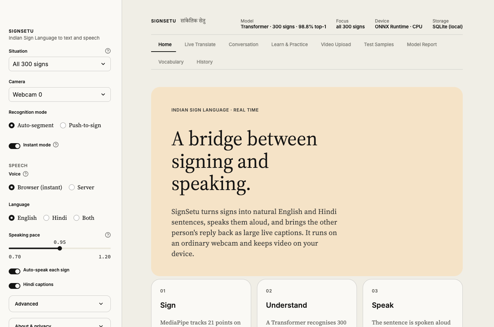
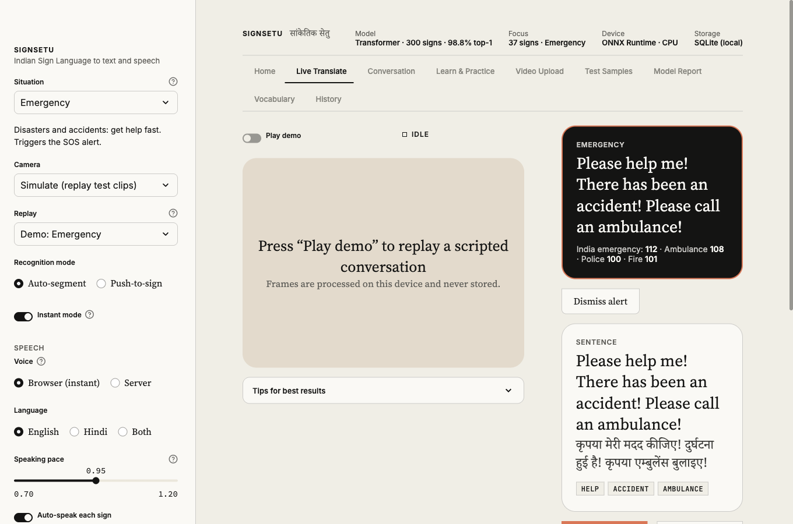
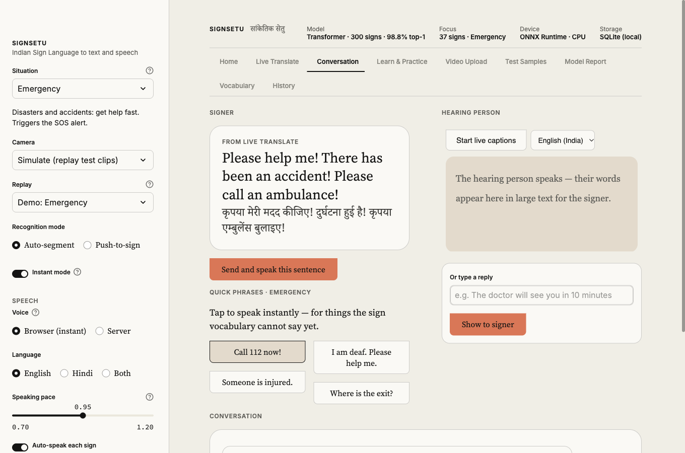
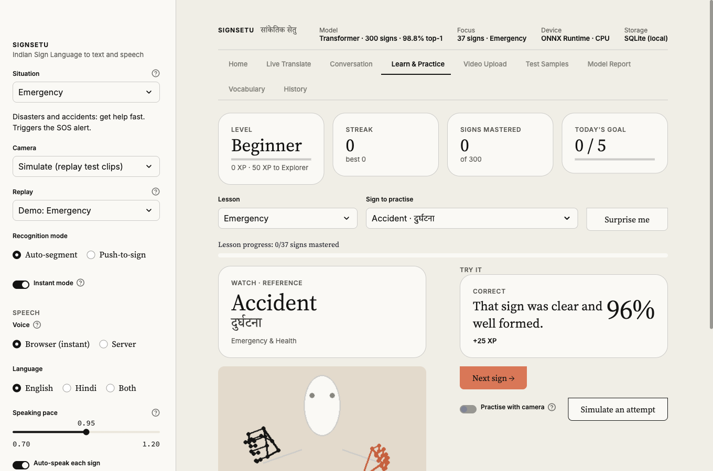

<div align="center">

# SignSetu · सांकेतिक सेतु

**Indian Sign Language to text and speech, in real time.**<br>
Signs become natural English and Hindi sentences, spoken aloud as you sign. The hearing person's reply comes back as large live captions.


**300 ISL signs · 98.8% test top-1 · about 1 ms inference on CPU · works offline**


</div>

---

## Why it matters

By widely cited estimates around 63 million people in India live with significant hearing loss, and there are only a few hundred certified ISL interpreters. At a clinic counter, a bank or a police station there is usually nobody to interpret, and pen and paper excludes people who are not fluent in written language.

SignSetu runs on an ordinary laptop webcam, needs no gloves or special hardware, keeps video on the device, and turns ISL into full sentences and speech. An emergency mode handles the moments where every second counts.


## Features

| | |
|---|---|
| **Real-time translation** | Instant mode commits a sign as soon as the model is sure (about 1.5 s into the Hospital demo), with a live "hearing …" guess while you sign. A fast latest-frame camera reader keeps the video from lagging behind. |
| **Sentences, not word lists** | An offline grammar engine turns ISL order into English and Hindi, including Hindi gender agreement (*मेरी किताब*). Optional Claude polish if `ANTHROPIC_API_KEY` is set. |
| **A voice that sounds human** | Browser speech picks the most natural installed voice, speaks sentence by sentence with natural pauses, lifts the pitch on questions and has a speaking-pace slider. |
| **Emergency SOS** | HELP, ACCIDENT, AMBULANCE, FIRE and PAIN trigger an alert, speak the request aloud and show India's emergency numbers: 112, ambulance 108, police 100, fire 101. |
| **Situation focus** | Everyday, Hospital, Emergency, Bank & Office, Classroom and Shopping presets narrow recognition to about 40 likely signs. |
| **Two-way conversation** | Quick phrases, live speech-to-text captions for the hearing person, typed replies and a downloadable transcript. |
| **Learn & Practice** | Reference replay for every sign, scores, XP, levels, streaks and coaching tips derived from your landmarks. |
| **Video upload** | Multi-sign clips are segmented, translated with timestamps and turned into a sentence. |
| **Runs out of the box** | SQLite is used automatically when PostgreSQL is not configured. No dataset, GPU or database is needed to run the app. |

The interface follows a parchment editorial style: paper tones, hairline borders, serif for content and sans for controls, and a single clay accent for the main action.

## Quick start

Trained models are in the repository, so this works on macOS, Linux and Windows without a GPU.

```bash
git clone https://github.com/harshit174/SignSetu.git
cd SignSetu
python3.11 -m venv .venv
source .venv/bin/activate            # Windows: .venv\Scripts\activate
pip install -r requirements.txt
streamlit run app.py
```

Open http://localhost:8501. History is stored in `data/signsetu.db` (SQLite, git-ignored) unless PostgreSQL is configured.

- **No webcam?** Choose *Simulate (replay test clips)* in the sidebar. Every demo replays real held-out clips through the live pipeline.
- **macOS camera:** allow the terminal (or IDE) that runs Streamlit under *System Settings → Privacy & Security → Camera*. The app picks the right capture backend per OS and tells you if the camera is blocked.
- **Speech** is best in Chrome or Edge. Live captions use the browser's speech recognition and need internet. For server-side speech on Linux install `espeak-ng`.
- **Contributors:** `pip install -r requirements-dev.txt && pytest`.

### Two-minute demo

1. **Home → Run the Hospital demo.** `HELLO I SICK DOCTOR WHERE` becomes *"Hello! I am sick. Where is the doctor?"* in English and Hindi, spoken as it is recognised.
2. **Home → Run the Emergency demo.** The SOS alert fires on HELP and the request is spoken.
3. **Conversation.** Tap a quick phrase, then type a reply as the hearing person, or start live captions in Chrome.
4. **Learn & Practice → Simulate an attempt.** Score, XP and streak update.
5. **Model Report** for the metrics, **History** for everything logged.

With a webcam, pick a situation, switch the camera on and sign.

## From signs to sentences

| Signed glosses (ISL order) | English | Hindi |
|---|---|---|
| `HELLO I SICK DOCTOR WHERE` | Hello! I am sick. Where is the doctor? | नमस्ते! मैं बीमार हूँ। डॉक्टर कहाँ है? |
| `HELP ACCIDENT AMBULANCE` | Please help me! There has been an accident! Please call an ambulance! | कृपया मेरी मदद कीजिए! दुर्घटना हुई है! कृपया एम्बुलेंस बुलाइए! |
| `GOOD MORNING I DEAF PLEASE SLOW` | Good morning! I am deaf. Please speak slowly. | सुप्रभात! मैं बधिर हूँ। कृपया धीरे बोलिए। |
| `SORRY MY BOOK WHERE` | I am sorry. Where is my book? | माफ़ कीजिए। मेरी किताब कहाँ है? |
| `YOU SAD WHY` | Why are you sad? | आप उदास क्यों हैं? |

## How it works

MediaPipe Holistic reduces each frame to hand and face landmarks, so the classifier never sees the image and does not depend on background, clothing or lighting. A segmenter finds where each sign starts and ends, a Transformer scores it, a confidence and margin gate decides whether to accept it, and the sentence engine builds the output.

```
camera → landmarks → segmenter → Transformer (temporal-crop ensemble)
       → situation focus → confidence gate → gloss sequence
       → sentence engine (English + Hindi) → speech · SOS · conversation · history
```

Details, the dataset decisions and the database schema are in [docs/architecture.md](docs/architecture.md).

## Results

<!-- METRICS:START -->
_Auto-generated by `SignSetu.ipynb` from `reports/metrics.json` (2026-11-02 16:32:23). Hardware: NVIDIA GeForce RTX 5050 Laptop GPU (8 GB, driver 615.78.08), AMD Ryzen 7 250 w/ Radeon 780M Graphics._

**Data used:** 300 sign classes + 1 reject class · train 41,319 · val 4,732 · in-domain test 4,732 · cross-domain test (MVI) 920

| Model | Params | Test top-1 | Test top-5 | Macro-F1 | Balanced acc. | Top-1 + TTA | Cross-domain top-1 (MVI) |
|---|---:|---:|---:|---:|---:|---:|---:|
| BiGRU baseline | 1.55 M | 98.59% | 99.78% | 98.73% | 98.66% | 98.57% | 81.63% |
| **Transformer (SignSetu)** | 2.32 M | **98.79%** | **99.78%** | **98.84%** | **98.83%** | 98.72% | **85.54%** |

Transformer reject-class recall: 94.21% · false-reject rate on sign clips: 0.17% · TTA enabled in app: no · trained 15.5 min (best epoch 171).

**Per-category test top-1 (Transformer):**

| Category | Top-1 |
|---|---:|
| Alphabet | 100.0% |
| Time & Frequency | 100.0% |
| Greetings & Phrases | 100.0% |
| Objects | 100.0% |
| Days | 100.0% |
| Question Words | 100.0% |
| Actions | 99.6% |
| Position & Direction | 99.5% |
| Numbers | 99.5% |
| Colors | 99.4% |
| Emergency & Health | 99.3% |
| Descriptions & Other | 98.0% |
| Pronouns | 96.0% |

**Latency** (single sample, AMD Ryzen 7 250 w/ Radeon 780M Graphics; GPU NVIDIA GeForce RTX 5050 Laptop GPU (8 GB, driver 615.78.08)):

| Stage | Mean | p95 |
|---|---:|---:|
| Transformer · PyTorch CUDA | 0.64 ms | 0.73 ms |
| Transformer · PyTorch CPU | 0.95 ms | 1.28 ms |
| Transformer · ONNX Runtime CPU | 0.63 ms | 0.88 ms |
| MediaPipe Holistic · CPU, 640 px | 10.5 ms / frame | — |

Estimated end-to-end real-time rate ≈ **90 FPS** (Holistic + best model path). Holistic benchmark input: CC BY-SA 4.0 sign-language clip (Wikimedia Commons), 1080p resized to 640 px.
<!-- METRICS:END -->

**How to read these numbers.** The in-domain test split comes from the same recordings the model trained on, and the dataset has no signer IDs, so treat it as an upper bound. The cross-domain (MVI) check uses a different data source that was never trained on, but covers only 10 of the 300 signs. The most common errors are semantically close pairs such as *Good ↔ Nice*. Accuracy on a new signer and camera has **not** been measured.


| | |
|---|---|
|  |  |

## Screenshots

| | |
|---|---|
| **Home**  | **Emergency SOS**  |
| **Conversation**  | **Learn & Practice**  |
| **Video Upload**  | **Test Samples**  |
| **Model Report**  | **Vocabulary**  |

## Project structure

```
SignSetu/
├── SignSetu.ipynb          source of truth: Run All trains, evaluates and generates the files below
├── app.py                  Streamlit UI (nine pages)              ┐
├── isl_core.py             features, models, segmenter, DB, speech │ generated from the notebook;
├── isl_lang.py             ISL → English/Hindi sentence engine     │ keep them in sync with
├── .streamlit/config.toml  theme and server settings               ┘ tools/sync_notebook.py
├── assets/
│   ├── theme.css           parchment stylesheet
│   ├── speech.js           browser voice engine
│   ├── favicon.png · demo.gif · figures/ · screenshots/
├── models/                 Transformer (.pt, .onnx), BiGRU baseline, label map, demo clips
├── reports/                metrics.json, per-class report
├── tests/                  sentence engine, vocabulary, inference, theme (pytest)
├── tools/sync_notebook.py  writes edited app files back into the notebook (--check for CI)
├── docs/                   architecture.md, training.md
├── .github/workflows/ci.yml
├── requirements.txt        app runtime (portable, no GPU)
├── requirements-train.txt  adds CUDA PyTorch and training tools
├── requirements-dev.txt    adds pytest
└── .env.example            configuration keys (no secrets)
```

Retraining from scratch (dataset, PostgreSQL, notebook flags) is covered in [docs/training.md](docs/training.md).

## Limitations

- **Isolated signs only.** Signs are segmented one at a time. There is no continuous sentence recognition, no fingerspelling of arbitrary words beyond letter by letter, and no full ISL grammar.
- **Rule-based sentences.** The engine covers the patterns the 300-sign vocabulary can express. Unusual orders fall back to a plain gloss sentence.
- **Feature fidelity.** The dataset documents its features in prose but ships no extraction code. We inferred the definition from the data and train with jitter to tolerate residual mismatch, but live accuracy on a new signer has not been measured systematically.
- **Signer generalisation.** No signer IDs exist, so in-domain scores are optimistic.
- **Speech.** Browser voices depend on the viewer's OS and browser. If no Hindi voice is installed the app speaks English. Live captions need Chrome or Edge and internet.
- **Platforms.** Developed on Fedora and verified on macOS. Windows is untested.
- **Next:** continuous recognition with CTC, a signer-disjoint evaluation and user study with ISL users, browser-side camera (WebRTC) for hosted deployment, and on-device mobile inference through the ONNX model.

## Responsible use and privacy

SignSetu is an **assistive prototype, not a certified interpreter**. In a real emergency call **112**. Video frames are processed locally and never stored. Only predicted words, confidence scores, practice scores and saved transcripts are logged, to local SQLite or PostgreSQL. Speech and live captions run in the viewer's browser. The optional AI polish sends only the gloss words to the Claude API and is off unless a key is configured.

## Team

**Team AlphaFire**: Kavay Khurana · Gurliv Singh · Harshit Atal

Built for **Neural Storm 2026** (JNTUH × Unstop), Track 01 Future Tech, **FT-04: Sign Language to Text/Speech Translator**.

## AI tools used

- **Claude** (Anthropic) helped design the project brief, architecture and evaluation plan.
- **Claude Code** (Anthropic) was used for implementation, debugging and testing, including the parchment UI, real-time Instant mode, the speech engine, the camera backend fix, the test suite and CI, and this README.

How the output was checked: the notebook was executed end to end and asserts leakage-freedom, feature determinism and ONNX/PyTorch parity. The app was driven through a headless browser (every page, the scripted situation demos, practice scoring, upload and history), and `pytest` runs in CI.

## Acknowledgements

- The authors of the **Vāksetu ISL Feature Dataset** ([Zenodo 23004815](https://zenodo.org/records/23004815)).
- The authors of **INCLUDE** (Sridhar, Ganesan, Kumar, Khapra) and **AI4Bharat**.
- **ISLRTC**, whose public sign videos the practice page links to.
- **Google MediaPipe**, **PyTorch**, **Streamlit**, **ONNX Runtime**, **PostgreSQL**, **SQLite** and the open-source community.
- The **Neural Storm 2026** and **JNTUH** organisers.
- Latency benchmarking used a short clip from Wikimedia Commons, *[Armenian Sign Language (ArSL) – new](https://commons.wikimedia.org/wiki/File:Armenian_Sign_Language_(ArSL)_-_%D5%B6%D5%B8%D6%80_-_new.webm)*, licensed CC BY-SA 4.0. It is downloaded on demand into the git-ignored `data/` folder and is not ISL.

<div align="center"><sub>सेतु = bridge</sub></div>
