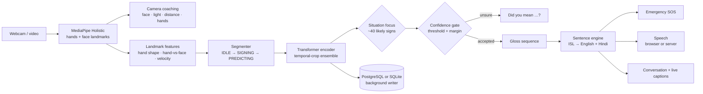

# Architecture

## Pipeline

- **Landmarks, not pixels.** The model never sees the image. MediaPipe Holistic reduces each frame to hand and face landmarks, so the classifier does not depend on background, clothing or lighting and is fast enough for CPU real time. Frames are processed locally and never stored.
- **Features.** Per hand: wrist-centred, scale-normalised hand shape; the hand relative to the face (nose tip, scaled by outer-eye-corner distance); frame-to-frame velocity; presence flags. 20 frames × 252 base values (velocity is recomputed) feed the model.
- **Segmentation.** A state machine (5-frame pre-roll, tolerant of single dropped detections) starts a sign when the hands become active and ends it after a configurable number of idle frames. Push-to-sign (countdown plus fixed capture) is the alternative.
- **Instant mode.** While a sign is still in progress the app scores a growing window. If the same sign tops 95% for three checks in a row, it commits early (`Segmenter.commit_early`) and waits for the hands to rest before listening again. The live "guess" line shows what the model currently hears. The camera reader keeps only the latest frame, so landmark extraction never falls behind the webcam.
- **Temporal-crop ensemble.** Live segmentation never cuts a sign exactly where the training clips start and end, so each segment is scored as the full span plus versions trimmed by 10–20% at either end, in one batch (~2 ms on CPU), and the probabilities are averaged.
- **Situation focus.** Probabilities are restricted to the selected situation's vocabulary (plus the reject class) and renormalised.
- **Confidence gate.** A word is added only if top-1 ≥ threshold **and** the top-1/top-2 margin is large enough; otherwise the app offers the top three. A sign split in two by the segmenter is not doubled.
- **Models.** A 2-layer BiGRU baseline and the main 4-layer pre-norm Transformer encoder with a CLS token, trained with GPU augmentation (mirror, rotation, temporal crop and speed, noise, hand blanking, frame hold, scale/offset jitter), AdamW with warm-up and cosine decay, label smoothing, AMP and early stopping. The Transformer is exported to ONNX (input normalisation included) and verified against PyTorch; ONNX Runtime CPU is the default engine.

## Sentence engine

`isl_lang.py` turns glosses into English and Hindi without a network. ISL is topic-comment and usually question-final, so the engine handles standalone phrases, wh-questions, subject + adjective with the right copula, "I need …", dative states (*मुझे दर्द है*), imperatives with *please*, noun + adjective, time words, fingerspelling and emergency words. Unusual orders fall back to a plain gloss sentence. When `ANTHROPIC_API_KEY` is set, an optional polish step rewrites the result; the offline engine is always tried first.

## Speech

- **Browser (default).** `assets/speech.js` picks the most natural installed voice for `en-IN` / `hi-IN` (neural, enhanced and Google voices are preferred; novelty and espeak voices are avoided), speaks one sentence at a time with a short breath between them and lifts the pitch on questions. Speed comes from the *Speaking pace* slider.
- **Server.** macOS `say`, Linux `espeak-ng` or Windows SAPI through `isl_core.speak_english`; gTTS is used for Hindi only when no local Hindi voice exists.

## Dataset

**Vāksetu ISL Feature Dataset (v1.0)**, Zenodo [23004815](https://zenodo.org/records/23004815): pre-computed MediaPipe-derived features only (no video or images), 20 frames × 506 values per sample. Not redistributed here; see the record for licence terms. The `MVI` domain was extracted from the **INCLUDE** videos: Sridhar, Ganesan, Kumar, Khapra, *INCLUDE: A Large Scale Dataset for Indian Sign Language Recognition*, ACM Multimedia 2020, [doi:10.1145/3394171.3413528](https://doi.org/10.1145/3394171.3413528) (CC BY 4.0).

| Step | Decision | Why |
|---|---|---|
| Integrity | SHA-256 of the HDF5 file is checked against the published checksum | detect a corrupt download |
| Features | Read the 252 base values per frame and **recompute velocity** as the frame difference | identical to the stored velocity on the webcam domain (max abs diff 0.0000) |
| Dropped column | The 253rd "hand-to-face proximity" column is excluded | its definition cannot be recovered, so the live pipeline could not reproduce it |
| De-duplication | 42,503 exact duplicate arrays and 1,084 arrays with conflicting labels removed | duplicates would leak across splits |
| Reject class | `negative` and `refining_negative` clips become a 301st class, **Not a sign** | lets the app abstain |
| Cross-domain hold-out | The whole `MVI` domain (920 clips, 10 classes) is never trained on | the only test with a different data source |
| In-domain split | Webcam/unknown clips split per class 80/10/10 (seed 42); synthetic and augmented variants are train-only | no official split exists |
| Leakage guard | The notebook asserts no array hash is shared between train / val / test / cross-domain | fails the run if violated |

The dataset has **no signer IDs**, so the in-domain test split may share signers with training. Read the in-domain numbers as an upper bound and the (10-class) cross-domain number as the more honest check.

## Storage

PostgreSQL when `PGHOST` / `PGPASSWORD` are configured and reachable, otherwise SQLite at `data/signsetu.db`. All writes go through a background thread, so a slow database never stalls the camera loop. No video frames or images are stored.

| Table (PostgreSQL, schema v2) | Purpose |
|---|---|
| `schema_meta` | schema version |
| `vocabulary` | the 300 signs + reject class: gloss, category, Hindi caption |
| `samples` | every dataset clip: source group, HDF5 index, domain, split, hash, hand coverage, exclusion flag |
| `training_runs` | one row per model run: config, device, params, best epoch, test metrics, checkpoint path |
| `epoch_metrics` | per-epoch loss / accuracy / learning rate |
| `class_metrics` | per-class precision / recall / F1 / support |
| `app_sessions` | one row per app session and mode (live / upload / sample) |
| `predictions` | every prediction: top-1, confidence, top-5, accepted?, corrected?, ground truth, timings |
| `transcripts` | saved transcripts with language |
| `practice_attempts` | Learn & Practice attempts: sign, score, success, source |

The SQLite fallback mirrors the app-side tables (`app_sessions`, `predictions`, `transcripts`, `practice_attempts`).
